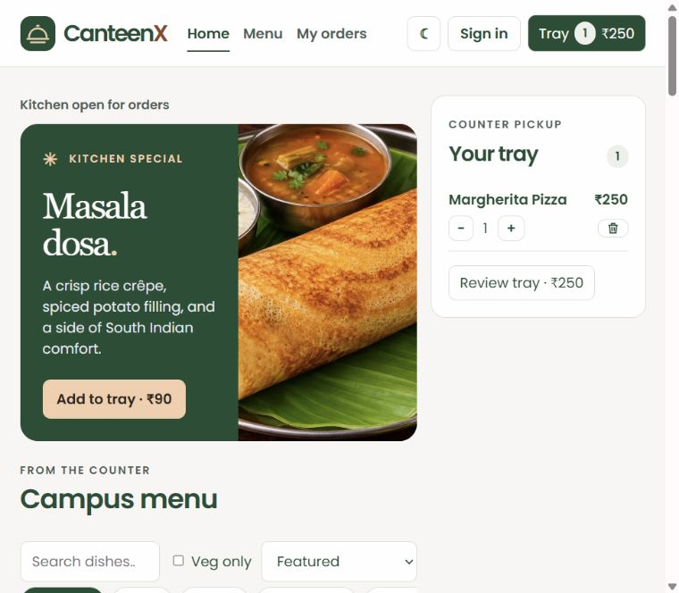

# CanteenX

A campus canteen ordering app by Zubed786. Students browse a 20-dish menu, build a tray, place an order, and pay at the counter. Staff manage availability and move pickup tickets from queued to preparing, ready, and collected.



## Run locally

Install Node.js 22.13 or newer. From the repository root run:

```sh
npm run setup
npm run build
npm start
```

Open [CanteenX on localhost](http://localhost:5000). Express serves the built React client and API together. The first start creates a SQLite database in `server/data/`. Accounts, sessions, order history, kitchen feedback, and availability persist across restarts. Saved trays are per account in the current browser.

## Try the full pickup flow

1. Browse as a guest, add a dish, then sign in or create an account from the tray.
2. Review the tray, optionally choose a pickup time and add instructions, then select **Place pickup order**. **My orders** shows the ticket number and status. Students can cancel queued orders and reorder a previous meal.
3. In a separate browser profile, create an account for the kitchen operator. Verify the account belongs to the operator, then grant that specific account kitchen access from the server terminal:
   ```sh
   npm run staff -- operator@example.com
   ```
4. Refresh the operator's page and open **Kitchen**. Start preparing the ticket, optionally set a ready time estimate, mark it ready, and confirm pickup when handed over. Tickets refresh every five seconds in the active tab. Staff can create dishes, edit prices and availability, and read feedback. Add `admin` after the email in the command above to grant that role. Both roles have kitchen access.

## Development

Run `npm run dev --prefix server` and `npm run dev --prefix client` in separate terminals. Vite proxies same-origin API requests to port 5000. Copy `client/.env.example` to `client/.env` to change the proxy target. Run `npm test` for the integration tests and `npm run build` for TypeScript checks and the production bundle. GitHub Actions runs both checks. [Open the Vite development server](http://localhost:5173)

The starter menu in `server/menu.json` seeds SQLite. Menu edits persist in SQLite, and existing orders retain the names, quantities and prices recorded at checkout. Passwords use salted scrypt hashes. Session tokens are random, hashed in the database, and delivered via HTTP-only cookies. Sign-in and signup requests are rate-limited.

## Hosting and storage

Run one Node service with a persistent disk. Copy `server/.env.example` to `server/.env` if you need to change defaults. Set `PORT` for the listener, `DATABASE_PATH` to an absolute path on the persistent disk, and `COOKIE_SECURE=true` behind HTTPS. Back up SQLite using an online SQLite backup or stop the service before copying its data directory. Checkout records a pay-at-counter order. The cashier collects the payment.

## Historical MongoDB orders

The previous version used email-only login. Ask each returning customer to create a password-based account and independently verify ownership before transferring their history. Export the original orders collection with `mongoexport --collection orders --jsonArray` using your original database connection and an output file outside the repository. Run the following from `server/` with the old MongoDB **user** ID and the verified destination email:

```sh
node import-orders.js /path/to/orders.json OLD_USER_ID verified@example.com
```

The importer preserves order dates, prices, quantities, and status. Repeating the import for the same account skips previously imported tickets. Keep backups of the original database and SQLite file. Original MongoDB passwords are never imported.
